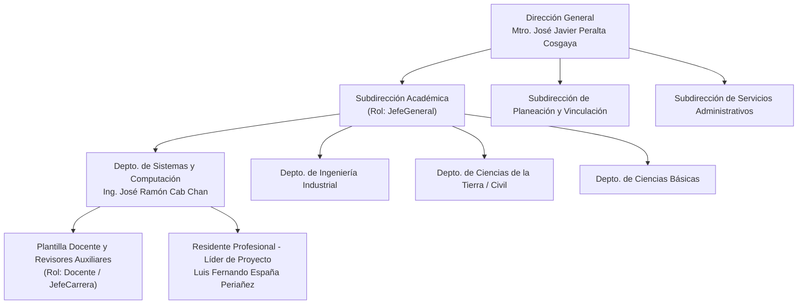

# 2. GENERALIDADES DEL PROYECTO

---

## 2.1 Introducción

En las instituciones de educación superior adscritas al **Tecnológico Nacional de México (TecNM)**, el seguimiento del proceso enseñanza-aprendizaje y la gestión del curso constituyen actividades esenciales para asegurar la calidad educativa y el cumplimiento de los programas de estudio por competencias. A lo largo de cada semestre escolar, los docentes deben presentar ante su respectiva Jefatura de Departamento Académico diversas evidencias documentales —tales como la Instrumentación Didáctica, Evaluaciones Diagnósticas, Instrumentos de Evaluación, Avances Programáticos y Actas de Calificaciones— divididas en cuatro momentos clave: *Reporte Inicial*, *Primer Seguimiento*, *Segundo Seguimiento* y *Reporte Final*. Paralelamente, deben reportar las estadísticas cuantitativas de aprobación, reprobación y deserción obtenidas por sus estudiantes en cada unidad temática evaluada.

Tradicionalmente, la recepción, validación y consolidación de estos entregables en el **Instituto Tecnológico de Campeche** se ha realizado mediante mecanismos dispersos (carpetas compartidas, correos electrónicos, medios de almacenamiento externo o formatos impresos) y hojas de cálculo independientes. Esta fragmentación dificulta el control de fechas límite, impide distinguir entre una entrega tardía y una corrección solicitada por la jefatura, retrasa la detección temprana de grupos con altos índices de reprobación ($\ge 40\%$) y demanda una elevada carga administrativa para construir las sábanas concentradas de rendimiento semestral.

Ante esta problemática, el presente proyecto de Residencia Profesional desarrolla e implementa el **Sistema Integral de Análisis y Reporte Académico (SIARA)**, una plataforma web centralizada y multi-departamental construida en **.NET 9** que digitaliza de extremo a extremo el ciclo de auditoría docente, automatiza el cálculo de indicadores académicos por carrera y proporciona tableros ejecutivos en tiempo real para la toma de decisiones oportunas.

---

## 2.2 Descripción de la organización y puesto de trabajo

### Datos Generales del Organismo Receptor
- **Nombre de la Institución:** Tecnológico Nacional de México / Instituto Tecnológico de Campeche (ITC).
- **Titular:** Mtro. José Javier Peralta Cosgaya *(Director)*.
- **Ubicación:** Km. 9 Carretera Campeche – Escárcega, Lerma, San Francisco de Campeche, Campeche, C.P. 24500.
- **Giro:** Educación Superior Tecnológica Pública.

### Misión Institucional
Formar profesionales competitivos en ciencia, tecnología y áreas afines, comprometidos con el desarrollo sostenible del estado de Campeche, la región y el país, a través de programas educativos pertinentes, investigación aplicada y vinculación con los sectores público, social y privado.

### Visión Institucional
Ser una institución de educación superior tecnológica líder en la región sureste de México, reconocida por la calidad acreditada de sus programas académicos, la excelencia de su planta docente y el impacto de sus egresados en la transformación tecnológica e industrial.

### Organigrama Institucional Relacionado con el Proyecto

### Descripción del Puesto de Trabajo del Residente
- **Puesto desempeñado:** Desarrollador Full-Stack y Líder de Proyecto en el Departamento de Sistemas y Computación.
- **Funciones principales:**
  1. Levantamiento y análisis de requerimientos operativos junto con la Jefatura de Departamento Académico.
  2. Diseño de la arquitectura de software (.NET 9 MVC) y modelado relacional de la base de datos `SiaraDB` en SQL Server.
  3. Programación de las reglas de negocio institucionales (candados jerárquicos, bloqueo secuencial de fases, validación de acciones correctivas y préstamos interdepartamentales).
  4. Desarrollo de interfaces de usuario responsivas apegadas a la identidad gráfica del TecNM.
  5. Implementación de los motores de exportación documental a Excel (`.xlsx`) y PDF (`.pdf`).
  6. Pruebas integrales, carga de catálogos reticulares y elaboración de documentación técnica y manuales de operación.

---

## 2.3 Problemas a resolver (priorizados)

A partir del diagnóstico realizado en el departamento académico, se identificaron y priorizaron las siguientes problemáticas críticas:

1. **Rezago y dispersión en la entrega física/digital de evidencias docentes y planeaciones didácticas:**  
   La ausencia de un repositorio único estructurado por periodo escolar, carrera, grupo y turno provocaba extravío de archivos PDF, duplicidad de versiones y dificultad para consultar el historial de una asignatura en semestres anteriores.
2. **Falta de control temporal estricto (fechas de corte y prórrogas) sin trazabilidad en reenvíos corregidos:**  
   No existía un mecanismo automatizado que registrara el instante exacto de carga inicial (`UploadedAt`) frente a la fecha límite del buzón (`DueDate`), ni que permitiera al docente subir una versión corregida tras una observación de la jefatura (`CorrectionSubmissionDate`) sin perder su estatus original de entrega a tiempo (`IsOnTime`). Asimismo, otorgar prórrogas requería avisos informales sin reflejo inmediato en el sistema.
3. **Cálculo manual y tardío de índices de reprobación, aprobación y deserción por unidad:**  
   Los Jefes de Carrera debían recopilar manualmente las listas de cada profesor para promediar los porcentajes de aprobación, reprobación y deserción departamental, demorando semanas en obtener la sábana concentrada del seguimiento.
4. **Carencia de planes remediales estructurados y auditables ante índices críticos de reprobación ($\ge 40\%$):**  
   Cuando un grupo presentaba una reprobación igual o superior al $40\%$ en una unidad temática, no existía un candado sistémico que obligara al docente a registrar una **Acción Correctiva (Estrategia Remedial)** en ese mismo instante, ni una bandeja de dictamen donde el Jefe de Carrera pudiera aprobar o rechazar dicha estrategia con retroalimentación formal.

---

## 2.4 Objetivos

### Objetivo General
Desarrollar e implementar la plataforma web integral **SIARA** (*Sistema Integral de Análisis y Reporte Académico*) para la gestión departamental, auditoría documental cronometrada y análisis estadístico en tiempo real de los indicadores escolares de aprobación, reprobación y deserción en el Instituto Tecnológico de Campeche.

### Objetivos Específicos
1. **Implementar un esquema de control de acceso basado en roles (RBAC) y seguridad jerárquica** mediante ASP.NET Core Identity (`Administrador`, `JefeGeneral`, `JefeCarrera` y `Docente`), incorporando candados de inmunidad para las cuentas titulares, alta descentralizada de profesores, auto-asignación del Jefe de Carrera y préstamo interdepartamental de docentes.
2. **Estructurar un módulo de Buzones Institucionales por fases** (*Reporte Inicial*, *1er Seguimiento*, *2do Seguimiento* y *Reporte Final*) con bloqueo de entrega secuencial obligatorio, soporte para prórrogas en fechas de corte y trazabilidad de segundas oportunidades de entrega (`CorrectionSubmissionDate`).
3. **Automatizar la captura y el cálculo de métricas académicas por unidad temática**, determinando de forma instantánea los porcentajes de aprobación, reprobación y deserción por asignatura, grupo y turno.
4. **Incorporar un disparador automático de Acción Correctiva obligatoria** cuando el índice de reprobación sea igual o mayor al $40\%$, dotando a la Jefatura de Carrera de una interfaz de dictamen para validar, aprobar o rechazar la estrategia remedial propuesta por el docente.
5. **Desarrollar un Panel Analítico ejecutivo con Semáforo de Cumplimiento y exportación oficial**, generando de manera dinámica las sábanas concentradas de calificaciones y reportes estadísticos en formatos **Excel (`.xlsx`)** y **PDF (`.pdf`)** mediante ClosedXML y QuestPDF.

---

## 2.5 Justificación

La implementación del sistema **SIARA** aporta beneficios tangibles tanto en el ámbito operativo como estratégico para el Instituto Tecnológico de Campeche:

- **Impacto Cuantitativo:**
  - **Reducción del tiempo de consolidación de sábanas departamentales en más de un $85\%$:** Los indicadores de aprobación, reprobación y deserción se calculan en el mismo segundo en que el docente registra sus unidades, eliminando el vaciado manual en hojas de cálculo.
  - **Eliminación del $100\%$ de omisiones en estrategias remediales:** Gracias a la validación en cliente y servidor, ningún seguimiento con reprobación $\ge 40\%$ puede guardarse sin su respectiva Acción Correctiva.
  - **Cero costos de licenciamiento adicional:** El uso de tecnologías multiplataforma de código abierto y licencias comunitarias (.NET 9, QuestPDF Community, ClosedXML) permite su operación institucional sin gastos recurrentes.

- **Impacto Cualitativo y Acreditaciones (CACEI / TecNM):**
  - **Transparencia y equidad en la evaluación docente:** La separación entre la fecha de entrega inicial (`UploadedAt`) y la fecha de envío de correcciones (`CorrectionSubmissionDate`) garantiza que los profesores que entregan a tiempo no sean penalizados en el semáforo de puntualidad al atender observaciones de mejora de su jefatura.
  - **Evidencia auditable para organismos acreditadores (CACEI):** Los comités de evaluación externa exigen evidencia sistematizada del seguimiento al desempeño escolar, detección de grupos en riesgo y aplicación de acciones de mejora continua. SIARA centraliza todo el expediente histórico por semestre, asignatura y docente, facilitando las auditorías de calidad educativa de las Jefaturas de Carrera y la Subdirección Académica.

