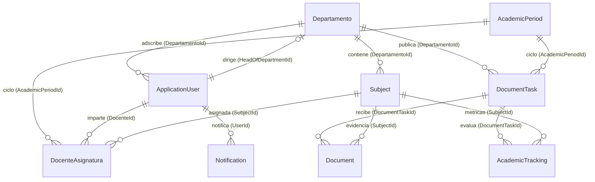

# 4. DESARROLLO

---

## 4.1 Procedimiento y descripción de las actividades realizadas

El desarrollo del **Sistema Integral de Análisis y Reporte Académico (SIARA)** se ejecutó de forma iterativa e incremental, abarcando seis fases técnicas principales: análisis de requerimientos, modelado de datos, construcción del backend, diseño del frontend institucional, programación de reglas de negocio y generación de reportes descargables.

---

### 4.1.1 Análisis y especificación de requerimientos

Se realizó el levantamiento de información en el Departamento de Sistemas y Computación del Instituto Tecnológico de Campeche, estableciendo la siguiente matriz de **Requerimientos Funcionales (RF)** y **Requerimientos No Funcionales (RNF)**:

#### Matriz de Requerimientos Funcionales (RF-01 al RF-19)

| Código | Nombre del Requerimiento | Descripción Técnica y Operativa | Prioridad |
| :--- | :--- | :--- | :---: |
| **RF-01** | Autenticación Institucional | Inicio y cierre de sesión seguro mediante correo electrónico institucional y contraseña cifrada con ASP.NET Core Identity. | Alta |
| **RF-02** | Control de Acceso Basado en Roles (RBAC) | Segregación del sistema en 4 perfiles: `Administrador`, `JefeGeneral` (Subdirección), `JefeCarrera` y `Docente`. | Alta |
| **RF-03** | Candado Jerárquico de Permisos | Protección en servidor que impide que cualquier usuario o revisor auxiliar modifique, degrade o revoque los permisos del Jefe de Carrera titular o del Administrador General. | Alta |
| **RF-04** | Comisiones de Revisión Auxiliar | Facultad del Jefe de Carrera para habilitar o revocar el rol auxiliar de revisión a docentes adscritos a su misma academia (`ToggleReviewerRole`). | Media |
| **RF-05** | Catálogo de Asignaturas con Semestre y Ordenamiento | Gestión CRUD de materias del plan de estudios incluyendo Clave, Nombre, Semestre ($1^\circ$ al $12^\circ$) y Departamento, con selector de ordenamiento dinámico (por semestre, nombre o clave). | Alta |
| **RF-06** | Alta Descentralizada de Docentes | Registro directo de nuevos profesores desde el panel del Jefe de Carrera, asignándoles automáticamente su departamento base y rol `Docente`. | Alta |
| **RF-07** | Préstamo Interdepartamental de Docentes | Asignación de materias de la carrera propia a docentes adscritos a otros departamentos del instituto, conservando la auditoría de la materia en el departamento dueño de la retícula. | Alta |
| **RF-08** | Auto-asignación del Jefe de Carrera | Inclusión del perfil del Jefe de Carrera titular dentro del directorio y selectores de docentes para permitirle asignarse grupos y materias cuando imparte clases. | Media |
| **RF-09** | Asignación con Grupo y Turno | Registro de `Group` (ej. *Grupo A*, *Grupo B*) y `Turno` (*Matutino*, *Vespertino*, *Mixto*) en la carga académica para evaluar grupos paralelos de una misma asignatura de forma independiente. | Alta |
| **RF-10** | Selectores Dinámicos de Periodos | Carga de ciclos escolares directamente desde la base de datos (`AcademicPeriods`) con creación automática bajo demanda al abrir buzones o asignar carga. | Media |
| **RF-11** | Apertura de Buzones por Fase | Creación de convocatorias de entrega (`DocumentTask`) clasificadas en 4 fases: `Inicial`, `Seguimiento1`, `Seguimiento2` y `Final`. | Alta |
| **RF-12** | Edición Flexible de Fechas de Corte (Prórrogas) | Modificación en tiempo real de la fecha y hora límite (`DueDate`) de cualquier buzón por parte del Jefe de Carrera para autorizar prórrogas. | Alta |
| **RF-13** | Bloqueo y Entrega Secuencial | Restricción en vista y controlador que bloquea el *2do Seguimiento* si no se ha entregado el *1er Seguimiento*, y bloquea el *Reporte Final* si no se ha entregado el *2do Seguimiento*. | Alta |
| **RF-14** | Carga de Evidencias PDF y Opción "No Aplica" | Subida de archivos validada exclusivamente en formato `.pdf` por rubro requerido, o registro del estatus `NoAplica` (`N/A`) con aprobación automática cuando el rubro no procede. | Alta |
| **RF-15** | Trazabilidad de Reenvíos sin Penalización | Almacenamiento separado de `UploadedAt` (primera entrega) y `CorrectionSubmissionDate` (reenvío tras rechazo), preservando el indicador `IsOnTime` original. | Alta |
| **RF-16** | Captura de Calificaciones y Acción Correctiva ($\ge 40\%$) | Cálculo automático de porcentajes de aprobación, reprobación y deserción por unidad; si `FailurePercentage >= 40%`, se exige obligatoriamente capturar la Acción Correctiva (`Observations`). | Alta |
| **RF-17** | Mesa de Dictamen Documental y Remedial | Interfaz para que la jefatura apruebe o rechace con retroalimentación escrita tanto los PDFs como los seguimientos por unidad y sus estrategias remediales. | Alta |
| **RF-18** | Panel Analítico con Deserción y Semáforo | Tablero departamental y global con KPIs de aprobación, reprobación, deserción, unidades en riesgo, Semáforo de 4 fases y Sábana Analítica. | Alta |
| **RF-19** | Segmentación de Notificaciones y Exportación Oficial | Clasificación de notificaciones en *Importantes* (tareas/fechas) y *Normales* (dictámenes), y descarga de sábanas en formatos `.xlsx` y `.pdf`. | Alta |

#### Matriz de Requerimientos No Funcionales (RNF-01 al RNF-05)

| Código | Atributo de Calidad | Especificación |
| :--- | :--- | :--- |
| **RNF-01** | Aislamiento Multi-Tenant | Ningún Jefe de Carrera ni Docente puede visualizar buzones, materias o estadísticas de departamentos ajenos a su adscripción o carga académica. |
| **RNF-02** | Integridad Histórica | Bloqueo de eliminación física de asignaturas o buzones que posean documentos PDF o calificaciones vinculadas en `SiaraDB`. |
| **RNF-03** | Identidad Visual Institucional | Cumplimiento de la paleta oficial del TecNM (`#112d60` Azul Marino y `#f4a915` Dorado) con diseño responsivo Bootstrap 5. |
| **RNF-04** | Codificación Internacional | Soporte UTF-8 completo en vistas Razor, migraciones SQL y reportes exportados para preservar acentos y caracteres del español. |
| **RNF-05** | Rendimiento y Concurrencia | Consultas asíncronas (`async/await`) en EF Core 9 y generación de reportes en memoria (`MemoryStream`) con tiempos de respuesta $< 2$ segundos. |

---

### 4.1.2 Modelado de base de datos (`SiaraDB`)

El modelo relacional fue implementado mediante **Entity Framework Core 9 Code-First** en la clase [`ApplicationDbContext.cs`](file:///C:/Users/Luis_/OneDrive/Documentos/Proyecto%20DevOps/SIARAWEB/SIARAWEB/Data/ApplicationDbContext.cs).

#### Diagrama Entidad-Relación (ERD) de `SiaraDB`



#### Diccionario Sintetizado de Tablas Principales
1. **`Departamentos` (`Departamento.cs`):** Almacena las carreras del instituto (`Id`, `Code`, `Name`, `HeadOfDepartmentId`).
2. **`AspNetUsers` (`ApplicationUser.cs`):** Extiende `IdentityUser` con `FullName`, `RFC` (13 caracteres), `CURP` (18 caracteres), `IsActive` y `DepartamentoId`.
3. **`Subjects` (`Subject.cs`):** Catálogo maestro de asignaturas por carrera (`Id`, `Code`, `Name`, `Semestre` de 1 a 12, `DepartamentoId`). Se precargaron planes de estudio completos como Ingeniería en Sistemas Computacionales e Ingeniería Industrial (Plan `IIND-2010-227` con 47 asignaturas de 1° a 8° semestre).
4. **`AcademicPeriods` (`AcademicPeriod.cs`):** Periodos semestrales (`Id`, `Name`, `StartDate`, `EndDate`, `IsActive`).
5. **`DocenteAsignaturas` (`DocenteAsignatura.cs`):** Asignación de carga académica por ciclo con soporte multi-grupo (`Id`, `DocenteId`, `SubjectId`, `AcademicPeriodId`, `Group`, `Turno`).
6. **`DocumentTasks` (`DocumentTask.cs`):** Buzones institucionales publicados por cada jefatura (`Id`, `Title`, `Description`, `PhaseType`, `DueDate`, `IsActive`, `AcademicPeriodId`, `DepartamentoId`).
7. **`Documents` (`Document.cs`):** Metadatos y estado de auditoría de cada PDF entregado (`Id`, `DocumentType`, `FilePath`, `UploadedAt`, `CorrectionSubmissionDate`, `IsOnTime`, `Status`, `ApprovalStatus`, `Feedback`, `SubjectId`, `DocumentTaskId`).
8. **`AcademicTrackings` (`AcademicTracking.cs`):** Calificaciones e indicadores por unidad temática (`Id`, `UnitNumber`, `TotalStudents`, `ApprovedStudents`, `FailedStudents`, `DroppedStudents`, `ApprovalPercentage`, `FailurePercentage`, `DropoutPercentage`, `Observations`, `ApprovalStatus`, `Feedback`, `SubjectId`, `DocumentTaskId`).
9. **`Notifications` (`Notification.cs`):** Avisos internos segmentados por tipo (`Id`, `UserId`, `Message`, `ActionUrl`, `Type` [`Importante` | `Normal`], `IsRead`, `CreatedAt`).

---

### 4.1.3 Implementación del Backend

La lógica de servidor se organizó en 9 controladores especializados dentro de la carpeta `Controllers/`:

1. **[`HomeController.cs`](file:///C:/Users/Luis_/OneDrive/Documentos/Proyecto%20DevOps/SIARAWEB/SIARAWEB/Controllers/HomeController.cs):** Renderiza el tablero inicial personalizado según el rol activo (resumen de materias y promedio personal para el Docente; KPIs departamentales de aprobación, reprobación y deserción para el Jefe de Carrera; vista global para el Jefe General; y conteo de cuentas para el Administrador), además de gestionar la lectura de notificaciones (`MarkNotificationRead`).
2. **[`DocentesController.cs`](file:///C:/Users/Luis_/OneDrive/Documentos/Proyecto%20DevOps/SIARAWEB/SIARAWEB/Controllers/DocentesController.cs):** Administra la plantilla docente del departamento. Incluye tanto a los usuarios con rol `Docente` como `JefeCarrera` para permitir la auto-asignación del jefe titular, gestiona el alta descentralizada (`Create`), el préstamo interdepartamental (`AssignTeacher`) y las comisiones de revisor auxiliar (`ToggleReviewerRole`) protegidas por el candado jerárquico.
3. **[`SubjectsController.cs`](file:///C:/Users/Luis_/OneDrive/Documentos/Proyecto%20DevOps/SIARAWEB/SIARAWEB/Controllers/SubjectsController.cs):** Gestiona el catálogo maestro de asignaturas del departamento con ordenamiento dinámico (`semestre_asc`, `semestre_desc`, `name_asc`, `name_desc`, `code_asc`, `code_desc`), vinculación de grupos/turnos y borrado seguro con captura de excepciones `DbUpdateException` para proteger materias con historial.
4. **[`DocumentTasksController.cs`](file:///C:/Users/Luis_/OneDrive/Documentos/Proyecto%20DevOps/SIARAWEB/SIARAWEB/Controllers/DocumentTasksController.cs):** Núcleo del flujo de trabajo. Provee la bandeja estilo *Classroom* para el profesor (`DocenteTasks`) filtrada estrictamente por los departamentos donde tiene carga o adscripción; la gestión de buzones y prórrogas para el jefe (`Index`, `Create`, `Edit`, `Delete`); y la mesa de auditoría y dictamen (`Review`, `ReviewDocument`, `ReviewTracking`, `SubjectHistory`).
5. **[`DocumentsController.cs`](file:///C:/Users/Luis_/OneDrive/Documentos/Proyecto%20DevOps/SIARAWEB/SIARAWEB/Controllers/DocumentsController.cs):** Procesa la carga física de archivos `.pdf` en `/wwwroot/uploads/documentos/`, asigna nombres únicos mediante `Guid`, distingue entre primera entrega y reenvío por corrección, y administra el estatus *No Aplica (`SetNotApplicable`)*.
6. **[`AcademicTrackingsController.cs`](file:///C:/Users/Luis_/OneDrive/Documentos/Proyecto%20DevOps/SIARAWEB/SIARAWEB/Controllers/AcademicTrackingsController.cs):** Recibe las métricas por unidad (`Capture`), ejecuta el cálculo porcentual automático y valida la obligatoriedad de la Acción Correctiva ante reprobación $\ge 40\%$.
7. **[`ReportsController.cs`](file:///C:/Users/Luis_/OneDrive/Documentos/Proyecto%20DevOps/SIARAWEB/SIARAWEB/Controllers/ReportsController.cs):** Construye el modelo `AnalyticsDashboardViewModel`, evalúa el Semáforo de Cumplimiento de las 4 fases, calcula los KPIs globales (incluyendo deserción) y genera los archivos descargables en PDF (`ExportPdf`) y Excel (`ExportExcel`).
8. **[`ApplicationUsersController.cs`](file:///C:/Users/Luis_/OneDrive/Documentos/Proyecto%20DevOps/SIARAWEB/SIARAWEB/Controllers/ApplicationUsersController.cs) y [`DepartamentosController.cs`](file:///C:/Users/Luis_/OneDrive/Documentos/Proyecto%20DevOps/SIARAWEB/SIARAWEB/Controllers/DepartamentosController.cs):** Módulos exclusivos del `Administrador` para la gestión global de usuarios, asignación de Jefes de Carrera titulares y administración de departamentos.

---

### 4.1.4 Desarrollo del Frontend Institucional

La capa de presentación se construyó con **Razor Views (`.cshtml`)** y **Bootstrap 5**, estandarizando la experiencia visual mediante:
- **Encabezado y Barra Lateral Institucional ([`_Layout.cshtml`](file:///C:/Users/Luis_/OneDrive/Documentos/Proyecto%20DevOps/SIARAWEB/SIARAWEB/Views/Shared/_Layout.cshtml) y [`_Sidebar.cshtml`](file:///C:/Users/Luis_/OneDrive/Documentos/Proyecto%20DevOps/SIARAWEB/SIARAWEB/Views/Shared/_Sidebar.cshtml)):** Uso del azul marino oficial del TecNM (`#112d60`) con acentos en dorado (`#f4a915`), logotipos institucionales y menú lateral adaptativo según el rol del usuario autenticado.
- **Campana de Notificaciones Segmentada:** Menú desplegable interactivo en la barra superior con contador de avisos no leídos y pestañas separadas (`Importantes` vs. `Normales`).
- **Componentes Modales y Alertas Dinámicas:** Ventanas modales para asignación de materias con grupo/turno, préstamo interdepartamental de profesores y formularios interactivos con validación en tiempo real en la vista de captura de calificaciones.

---

### 4.1.5 Reglas de Negocio Programadas

1. **Entrega Secuencial de Seguimientos:**  
   En `DocumentsController.Upload`, `AcademicTrackingsController.Capture` y `DocenteTasks.cshtml`, antes de permitir el acceso o guardado en un buzón cuya fase sea `Seguimiento2`, el sistema consulta si la asignatura ya cuenta con registros en `Seguimiento1` del mismo periodo escolar. De igual forma, para la fase `Final`, exige que exista entrega previa en `Seguimiento2`. Si no se cumple, muestra el bloqueo *"Fase Bloqueada: Entrega previa requerida"*.
2. **Reenvíos sin Penalizar Puntualidad (`CorrectionSubmissionDate`):**  
   En `DocumentsController.UploadTaskDocument`, cuando `existingDoc == null` (primera subida), se compara `DateTime.Now <= task.DueDate` para fijar `IsOnTime` y `Status` (`EnTiempo` o `Atrasado`). Cuando el docente sube una corrección (`existingDoc != null`), se reemplaza el archivo PDF anterior y se actualiza `CorrectionSubmissionDate = DateTime.Now` y `ApprovalStatus = "Pendiente"`, manteniendo intactos `UploadedAt` e `IsOnTime`.
3. **Validador de Acción Correctiva Obligatoria ($\ge 40\%$ de Reprobación) y Dictamen:**  
   En `AcademicTrackingsController.Capture`:
   ```csharp
   if (tracking.TotalStudents > 0)
   {
       tracking.ApprovalPercentage = Math.Round(((decimal)tracking.ApprovedStudents / tracking.TotalStudents) * 100, 2);
       tracking.FailurePercentage = Math.Round(((decimal)tracking.FailedStudents / tracking.TotalStudents) * 100, 2);
       tracking.DropoutPercentage = Math.Round(((decimal)tracking.DroppedStudents / tracking.TotalStudents) * 100, 2);
   }

   if (tracking.FailurePercentage >= 40 && string.IsNullOrWhiteSpace(tracking.Observations))
   {
       ModelState.AddModelError(nameof(tracking.Observations),
           "La acción correctiva es obligatoria cuando el índice de reprobación es igual o superior al 40%.");
   }
   ```
   A su vez, en `DocumentTasksController.ReviewTracking`, el Jefe de Carrera revisa la unidad y su estrategia remedial, emitiendo el dictamen de aprobación o rechazo y disparando una notificación automática al docente.
4. **Algoritmo del Semáforo de Cumplimiento:**  
   En `ReportsController.Index`, cada asignatura asignada en el semestre activo se evalúa en las 4 fases (`Inicial`, `Seguimiento1`, `Seguimiento2`, `Final`), asignando `bg-secondary` (Gris) si no existen entregas, `bg-danger` (Rojo) si algún documento fue entregado fuera de tiempo (`!d.IsOnTime`), o `bg-success` (Verde) cuando las entregas se realizaron puntualmente.

---

### 4.1.6 Generación de Reportes Oficiales (Excel y PDF)

En [`ReportsController.cs`](file:///C:/Users/Luis_/OneDrive/Documentos/Proyecto%20DevOps/SIARAWEB/SIARAWEB/Controllers/ReportsController.cs) se programaron dos endpoints de exportación directa que respetan los filtros activos de periodo escolar, departamento y búsqueda:
- **`ExportExcel` (ClosedXML):** Genera un libro `.xlsx` con la hoja `"Sabana Analitica"`, encabezados estilizados con fondo `#112d60` y texto blanco, columnas de Clave, Asignatura, Docente, Unidades Evaluadas, `% Aprobación`, `% Reprobación`, `% Deserción` y Estatus (`ALTO RIESGO` en rojo o `Normal`), descargándose mediante `File(stream.ToArray(), "application/vnd.openxmlformats-officedocument.spreadsheetml.sheet", ...)`.
- **`ExportPdf` (QuestPDF):** Compone un documento en orientación horizontal (`PageSizes.Letter.Landscape()`) con encabezado oficial del **Tecnológico Nacional de México - Sistema Integral de Análisis y Reportes Académicos (SIARA)**, tabla resumen de indicadores por materia y pie de página con fecha de generación y numeración de páginas.

