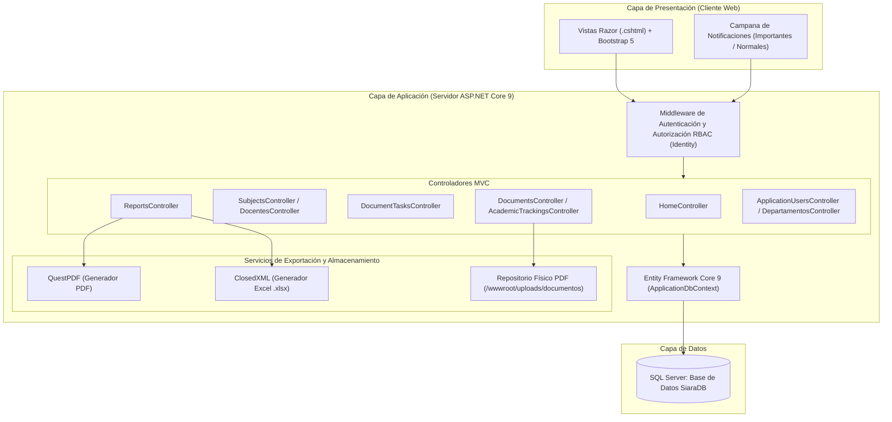
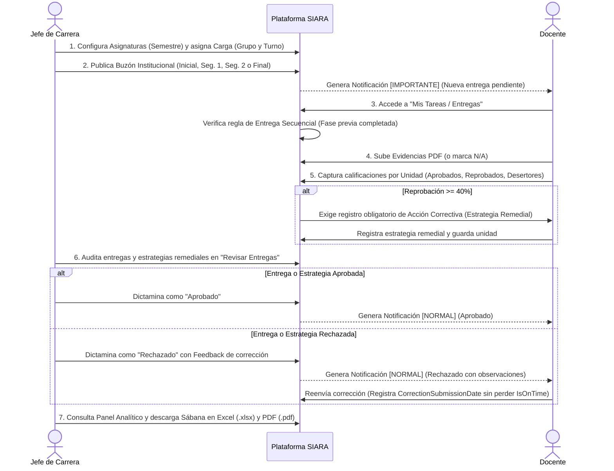

# 5. RESULTADOS

---

## 5.1 Resultados, pantallas, prototipos, manuales y modelos

La implementación del **Sistema Integral de Análisis y Reporte Académico (SIARA)** dio como resultado una aplicación web funcional, segura y alineada con la identidad institucional del Tecnológico Nacional de México.

---

### 5.1.1 Pantallas del sistema (Guía de Evidencias Visuales)

A continuación se describen las interfaces clave desarrolladas en el sistema *(en el documento final de Word/PDF se insertan las capturas correspondientes en cada recuadro)*:

1. **Pantalla de Inicio de Sesión (`Areas/Identity/Pages/Account/Login.cshtml`) y Tablero Principal (`Views/Home/Index.cshtml`):**
   - Muestra el acceso institucional con logotipos del TecNM e ITC, seguido del panel personalizado con indicadores rápidos de asignaturas activas, documentos subidos, tasa global de aprobación, reprobación y deserción del periodo activo, y la campana superior de notificaciones segmentadas en *Importantes* y *Normales*.
2. **Catálogo Maestro de Asignaturas con Semestre y Ordenamiento (`Views/Subjects/Index.cshtml`):**
   - Despliega el listado de materias del departamento con su insignia de semestre (`1° Semestre` al `9° Semestre`), clave oficial, nombre y selector desplegable para ordenar dinámicamente por Semestre, Nombre o Clave.
3. **Directorio de Plantilla Docente, Auto-asignación y Préstamo Interdepartamental (`Views/Docentes/Index.cshtml` y `Details.cshtml`):**
   - Presenta las tarjetas de métricas docentes, la distinción entre profesores adscritos a la academia, el **Jefe Titular** (habilitado para auto-asignarse materias) y docentes de apoyo de otras carreras, junto con los modales de *Préstamo de Docente* y *Asignar Materia* con Grupo y Turno.
4. **Bandeja de Tareas del Docente y Bloqueo Secuencial (`Views/DocumentTasks/DocenteTasks.cshtml`):**
   - Interfaz tipo *Classroom* que agrupa las asignaturas del profesor dentro de cada buzón activo, mostrando insignias de estado (`DOCS OK`, `CALIF OK`) y el candado de seguridad (*"Fase Bloqueada: Entrega previa requerida"*) en el 2do Seguimiento o Reporte Final cuando la fase previa no ha sido entregada.
5. **Subida de Evidencias Documentales PDF y Opción N/A (`Views/Documents/Upload.cshtml`):**
   - Muestra los rubros requeridos según la fase del buzón, permitiendo cargar archivos `.pdf`, marcar rubros como *No Aplica (N/A)*, visualizar el estatus de puntualidad (*En Tiempo* / *Atrasado*) y reenviar correcciones tras observaciones de la jefatura.
6. **Captura de Calificaciones por Unidad con Alerta del 40% (`Views/AcademicTrackings/Capture.cshtml`):**
   - Formulario interactivo que calcula en vivo los porcentajes de aprobación, reprobación y deserción al ingresar las cantidades de alumnos. Cuando la reprobación alcanza o supera el **$40\%$**, despliega la alerta de riesgo y exige obligatoriamente registrar la **Acción Correctiva (Estrategia Remedial)**.
7. **Mesa de Dictamen de Jefatura (`Views/DocumentTasks/Review.cshtml`):**
   - Vista de auditoría para el Jefe de Carrera donde inspecciona los PDFs y las tablas de unidades por materia/grupo, resaltando en color ámbar/rojo las estrategias remediales de unidades con reprobación $\ge 40\%$ para aprobarlas o rechazarlas con retroalimentación.
8. **Panel Analítico: Semáforo de Cumplimiento y Sábana Concentrada (`Views/Reports/Index.cshtml` y `Details.cshtml`):**
   - Tablero ejecutivo con filtros por periodo escolar y departamento, tarjetas KPI (Total Asignaturas, % Aprobación, % Reprobación, % Deserción y Unidades de Riesgo), pestaña de Semáforo de 4 fases, Sábana Analítica y botones de descarga directa **Exportar PDF** y **Exportar Excel**.

---

### 5.1.2 Diagramas de arquitectura y flujo del sistema

#### A. Diagrama de Arquitectura Multicapa (.NET 9 MVC)

#### B. Diagrama de Flujo Operativo del Proceso de Auditoría y Dictamen

---

### 5.1.3 Manual de usuario sintetizado por rol

| Rol del Sistema | Módulos Habilitados | Operaciones Principales paso a paso |
| :--- | :--- | :--- |
| **Administrador (TI)** | `Gestión de Usuarios`, `Departamentos y Carreras` | 1. Crear departamentos/carreras y asignar al Jefe de Carrera titular. 2. Dar de alta cuentas globales y asignar roles. 3. Activar o suspender cuentas (con candado de inmunidad sobre cuentas raíz). |
| **Jefe General (Subdirección)** | `Inicio`, `Panel Analítico` | 1. Consultar los indicadores globales de todas las ingenierías del instituto. 2. Filtrar el Semáforo de Entregas y la Sábana Analítica por departamento y ciclo escolar. 3. Exportar concentrados institucionales en Excel (`.xlsx`) y PDF (`.pdf`). |
| **Jefe de Carrera** | `Inicio`, `Mis Tareas`, `Asignaturas`, `Plantilla Docente`, `Buzones Institucionales`, `Panel Analítico` | 1. Administrar las asignaturas de su carrera y ordenarlas por semestre, nombre o clave. 2. Dar de alta docentes en su departamento, gestionar préstamos de otras carreras, comisionar revisores auxiliares y auto-asignarse materias si imparte cátedra. 3. Asignar materias especificando **Grupo** y **Turno**. 4. Abrir buzones por fase y editar fechas límite para otorgar **prórrogas**. 5. Dictaminar PDFs, seguimientos y **Acciones Correctivas ($\ge 40\%$)**. 6. Auditar el Semáforo, la tasa de deserción y exportar sábanas a PDF y Excel. |
| **Docente** | `Inicio`, `Mis Tareas / Entregas` | 1. Revisar avisos de nuevos buzones en la pestaña *Importantes* de la campana de notificaciones. 2. Ingresar a *Mis Tareas / Entregas* y subir los archivos `.pdf` requeridos (o marcar *N/A*) respetando el orden secuencial de fases. 3. Capturar las calificaciones por unidad temática y redactar la **Acción Correctiva** cuando la reprobación sea $\ge 40\%$. 4. Atender observaciones en la pestaña *Normales* y reenviar correcciones. |

---

### 5.1.4 Estudio técnico del despliegue en servidor web y base de datos SQL Server

Para la puesta en producción del sistema **SIARA** en la infraestructura del Instituto Tecnológico de Campeche, se establecieron las siguientes especificaciones técnicas de despliegue:

1. **Entorno de Servidor de Aplicaciones:**
   - **Sistema Operativo:** Windows Server 2019 / 2022 (con IIS 10 y *ASP.NET Core 9.0 Hosting Bundle*) o servidor Linux Ubuntu 22.04 LTS con proxy inverso Nginx sobre Kestrel.
   - **Procesador y Memoria:** Mínimo 2 vCPU a 2.4 GHz y 4 GB de memoria RAM (8 GB recomendados para concurrencia en cierres de seguimiento).
   - **Almacenamiento de Evidencias:** Partición con al menos 50 GB disponibles y permisos de lectura/escritura (`Modify`) para el grupo de aplicaciones (`IIS_IUSRS` / servicio de aplicación) sobre el directorio `/wwwroot/uploads/documentos/`.
2. **Motor de Base de Datos:**
   - **SGBD:** Microsoft SQL Server 2019 / 2022 (Express, Standard o Enterprise).
   - **Intercalación (*Collation*):** `Modern_Spanish_CI_AS` con soporte de tipos Unicode (`NVARCHAR`) para garantizar la correcta persistencia de acentos y eñes en nombres de asignaturas y docentes.
   - **Inicialización de Esquema:** Ejecución automatizada de las migraciones de Entity Framework Core (`dotnet ef database update`) y sembrado inicial de roles y catálogos mediante la clase `DbSeeder`.

---

## 5.2 Actividades sociales

Durante el desarrollo e implantación del proyecto en el **Instituto Tecnológico de Campeche**, se llevaron a cabo actividades de impacto social y apoyo directo a la comunidad académica del plantel:

1. **Acompañamiento y asesoría tecnológica al personal docente y jefaturas académicas:** Se realizaron sesiones de demostración práctica sobre el uso de los buzones digitales, la carga de evidencias en formato PDF, la configuración de grupos/turnos y el flujo de dictamen de estrategias remediales, facilitando la transición digital de profesores de distintas edades y perfiles.
2. **Digitalización y estandarización de planes de estudio reticulares:** Se colaboró con las jefaturas académicas en la depuración, codificación UTF-8 y carga sistematizada de los catálogos oficiales de asignaturas por semestre (incluyendo los planes de Ingeniería en Sistemas Computacionales e Ingeniería Industrial `IIND-2010-227`), dejando una base de datos limpia y reutilizable para los próximos ciclos escolares.
3. **Fomento a la cultura de reducción de papel (*Cero Papel*):** Con la sustitución de carpetas físicas e impresiones de avances programáticos por expedientes digitales auditables en SIARA, se contribuyó activamente a las metas ambientales y de ahorro de insumos del Sistema de Gestión Ambiental del instituto.

