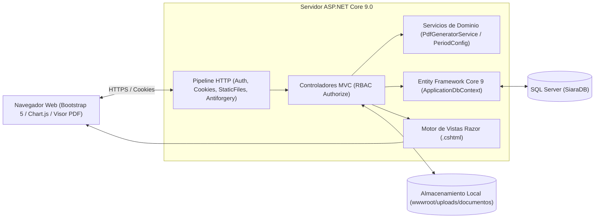

# 1. Arquitectura del Sistema y Stack Tecnológico — SIARAWEB

## 1.1 Visión General de la Arquitectura
**SIARAWEB** (Sistema Integral de Análisis y Reporte Académico) está construido bajo el patrón arquitectónico **Modelo-Vista-Controlador (MVC)** sobre la plataforma **ASP.NET Core 9.0**. El diseño separa de forma estricta la capa de datos y reglas de dominio (**Modelos + Servicios**), la interfaz de usuario (**Vistas Razor `.cshtml`**) y la orquestación de peticiones HTTP y seguridad (**Controladores**).



---

## 1.2 Stack Tecnológico Detallado

| Componente | Tecnología / Paquete | Versión | Propósito en el Sistema |
| :--- | :--- | :--- | :--- |
| **Framework Base** | `.NET SDK` / `ASP.NET Core MVC` | `9.0` | Ejecución del servidor web, enrutamiento MVC, inyección de dependencias y pipeline HTTP. |
| **ORM** | `Microsoft.EntityFrameworkCore.SqlServer` | `9.0.x` | Mapeo objeto-relacional (Code-First), consultas LINQ asíncronas y control de migraciones. |
| **Seguridad y Autenticación** | `Microsoft.AspNetCore.Identity.EntityFrameworkCore` | `9.0.x` | Gestión de usuarios, hash de contraseñas, bloqueo de cuentas por intentos fallidos y control de roles (`RBAC`). |
| **Persistencia Criptográfica** | `Microsoft.AspNetCore.DataProtection.EntityFrameworkCore` | `9.0.x` | Almacenamiento de llaves de cifrado de cookies y tokens anti-falsificación (`Antiforgery`) en base de datos (`DataProtectionKeys`). |
| **Motor de Reportes PDF** | `QuestPDF` | `2026.x` | Generación fluida en memoria de documentos PDF institucionales (Reporte Ejecutivo General, Semáforo, Sábana y Reporte por Docente). |
| **Motor de Reportes Excel** | `ClosedXML` | `0.104.x` | Creación dinámica de libros de cálculo `.xlsx` con formato condicional para la Sábana Concentrada de Rendimiento. |
| **Frontend UI** | `Bootstrap 5` + `Bootstrap Icons` + `Chart.js` | `5.3.x` | Diseño responsivo institucional, modales asíncronos, tarjetas interactivas y gráficas estadísticas en tiempo real. |

---

## 1.3 Estructura de Directorios del Proyecto

```text
SIARAWEB/
├── SIARAWEB.sln                         # Solución principal de Visual Studio
├── README.md                            # Resumen general del repositorio
├── Documentacion_Tecnica/               # Documentación técnica profunda de ingeniería
└── SIARAWEB/                            # Proyecto web principal ASP.NET Core 9
    ├── Areas/Identity/                  # Páginas Razor de autenticación y perfil (Login, Logout, Manage)
    ├── Controllers/                     # Controladores MVC con reglas de negocio y autorización por rol
    ├── Data/
    │   └── ApplicationDbContext.cs      # Contexto EF Core, DbSets y configuración Fluent API
    ├── Migrations/                      # Historial de migraciones Code-First de SQL Server
    ├── Models/                          # Entidades de dominio y modelos de configuración
    ├── Services/
    │   └── PdfGeneratorService.cs       # Servicio de generación de reportes PDF con QuestPDF
    ├── ViewModel/                       # Modelos compuestos para vistas analíticas e historiales
    ├── Views/                           # Vistas Razor (.cshtml) organizadas por controlador
    │   ├── Shared/                      # Layouts (_Layout.cshtml, _Sidebar.cshtml, _LoginPartial.cshtml)
    │   ├── Home/                        # Lobby dinámico adaptado según el rol del usuario
    │   ├── Docentes/                    # Gestión de plantilla docente, asignaciones y comisiones
    │   ├── Subjects/                    # Catálogo de asignaturas con filtro y orden por semestre
    │   ├── DocumentTasks/               # Buzones cronometrados, vista docente y mesa de dictamen
    │   ├── Documents/                   # Carga y reemplazo de evidencias en formato PDF
    │   ├── AcademicTrackings/           # Captura de calificaciones por unidad y acción correctiva
    │   ├── Reports/                     # Tablero analítico (KPIs, Semáforo, Sábana y Visor PDF)
    │   ├── AcademicPeriods/             # Configuración de periodos escolares y etiquetas globales
    │   ├── Departamentos/               # Gestión de departamentos académicos y jefaturas
    │   ├── ApplicationUsers/            # Administración técnica de usuarios y roles
    │   └── Notifications/               # Bandeja segmentada de notificaciones
    ├── wwwroot/                         # Archivos estáticos (CSS institucional, JS, librerías y uploads)
    ├── Program.cs                       # Punto de entrada, configuración de DI, middleware y Data Seeding
    └── appsettings.json                 # Configuración de cadena de conexión y parámetros de entorno
```

---

## 1.4 Pipeline de Inicialización (`Program.cs`)
Al iniciar la aplicación, `Program.cs` ejecuta las siguientes etapas críticas:
1. **Inicialización de QuestPDF:** Configura la licencia `LicenseType.Community`, habilita la compatibilidad con fuentes del sistema (`UseSystemFonts = true`) y desactiva excepciones por glifos o familias tipográficas faltantes (`ThrowOnMissingTextGlyphs = false`, `ThrowOnMissingFontFamilies = false`).
2. **Registro de Base de Datos y Data Protection:** Registra `ApplicationDbContext` sobre SQL Server y persiste las llaves criptográficas en la tabla `DataProtectionKeys` para evitar cierres de sesión inesperados tras reinicios del servidor.
3. **Políticas de Seguridad de Identity:**
   - Bloqueo temporal de cuenta por **15 minutos** tras **3 intentos fallidos** de inicio de sesión (`MaxFailedAccessAttempts = 3`).
   - Contraseñas con longitud mínima de 8 caracteres, requerimiento de dígitos y caracteres especiales.
4. **Filtro Global de Autenticación:** Aplica `AuthorizeFilter` por defecto a todos los controladores MVC, exigiendo sesión activa salvo en el área pública de `Identity/Account/Login`.
5. **Semilla Automática (`Data Seeding`):** Verifica y crea automáticamente en el arranque los 4 roles del sistema (`Administrador`, `JefeGeneral`, `JefeCarrera`, `Docente`) y el usuario administrador inicial si no existen.
