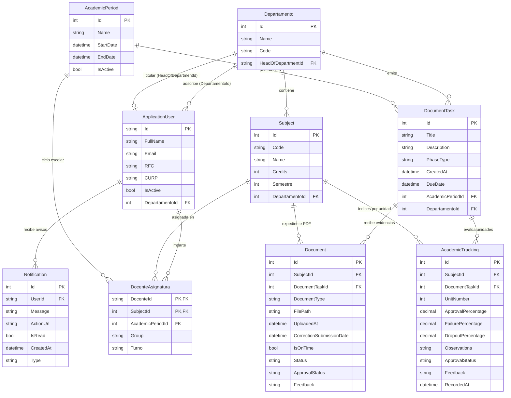

# 2. Modelo de Datos y Base de Datos (`SiaraDB`)

## 2.1 Diagrama Entidad-Relación (ERD)
El modelo relacional de **SIARAWEB** está implementado mediante **Entity Framework Core 9 Code-First**. Todas las relaciones críticas utilizan `DeleteBehavior.Restrict` en `ApplicationDbContext.OnModelCreating` para evitar pérdidas accidentales de historial académico por borrados en cascada.

---

## 2.2 Diccionario de Entidades Principales

### 1. `ApplicationUser` (Extiende `IdentityUser`)
Representa a cualquier usuario del sistema (Administrador, Subdirector/Jefe General, Jefe de Carrera o Docente).
- `Id` (`string`, GUID): Identificador único de ASP.NET Core Identity.
- `FullName` (`string`): Nombre completo del docente o funcionario.
- `RFC` (`string?`), `CURP` (`string?`): Identificadores fiscales/administrativos opcionales.
- `IsActive` (`bool`): Estado de la cuenta en el sistema.
- `DepartamentoId` (`int?`): Departamento académico de adscripción base del usuario.

### 2. `Departamento`
Representa cada academia o división de carrera profesional.
- `Id` (`int`): Clave primaria.
- `Name` (`string`): Nombre oficial de la carrera o departamento (ej. *Ingeniería en Sistemas Computacionales*, *Ingeniería Industrial*, *Ingeniería Civil*).
- `Code` (`string`): Acrónimo o clave corta (ej. `ISC`, `IIND`, `ICIV`).
- `HeadOfDepartmentId` (`string?`): Referencia al `ApplicationUser` que funge como **Jefe de Carrera Titular**, protegiendo su jerarquía frente a revisores auxiliares.

### 3. `Subject` (Asignatura)
Catálogo de materias de los planes de estudio.
- `Id` (`int`): Clave primaria.
- `Code` (`string`): Clave oficial de la materia (ej. `AED-1285`, `INC-1001`).
- `Name` (`string`): Nombre oficial de la asignatura.
- `Credits` (`int`): Número total de créditos SATCA.
- `Semestre` (`int`): Semestre de ubicación reticular (`1` al `9`).
- `DepartamentoId` (`int`): Carrera dueña de la asignatura.

### 4. `DocenteAsignatura` (Carga Académica)
Tabla intermedia enriquecida con clave primaria compuesta `(DocenteId, SubjectId)`.
- `DocenteId` (`string`): Profesor que imparte la asignatura (puede pertenecer al mismo departamento o estar **en préstamo** desde otro departamento).
- `SubjectId` (`int`): Asignatura asignada.
- `AcademicPeriodId` (`int?`): Periodo escolar de la asignación.
- `Group` (`string`): Grupo académico y modalidad (ej. `Grupo A - Matutino`).
- `Turno` (`string`): Turno explícito (`Matutino`, `Vespertino`, `Mixto`).

### 5. `AcademicPeriod` y `PeriodConfig`
Gestión de ciclos escolares.
- `AcademicPeriod`: Almacena en SQL Server el periodo (`Id`, `Name`, `StartDate`, `EndDate`, `IsActive`).
- `PeriodConfig`: Configuración persistida en `period_settings.json` administrada por TI que define las etiquetas válidas para los selectores dinámicos de periodos (`Periodo1`, `Periodo2`, `PeriodoExtra`), permitiendo que las jefaturas combinen `Semestre / Periodo` + `Año` de forma automática.

### 6. `DocumentTask` (Buzón / Seguimiento Cronometrado)
Representa cada fase de entrega abierta por una Jefatura de Carrera.
- `PhaseType` (`string`): Tipo de fase (`Inicial`, `Seguimiento1`, `Seguimiento2`, `Final`).
- `Title` (`string`): Título descriptivo del buzón.
- `DueDate` (`DateTime`): Fecha y hora límite oficial para evaluar si las entregas son puntuales (`IsOnTime`). Modificable para otorgar prórrogas.
- `AcademicPeriodId` (`int`): Ciclo escolar asociado.
- `DepartamentoId` (`int?`): Departamento que emite y audita el buzón.

### 7. `Document` (Evidencia Documental PDF)
Registro de cada archivo subido o marcado como No Aplica por el docente.
- `DocumentType` (`string`): Nombre del documento requerido según la fase (ej. `Instrumentación Didáctica`, `Instrumentos de Evaluación`, `Prácticas de Laboratorio`, `Evaluación Diagnóstica`, `Avance Programático (apart. 6)`, `Acta de Calificaciones`).
- `FilePath` (`string`): Ruta relativa al archivo en `/uploads/documentos/...` o `"N/A"`.
- `UploadedAt` (`DateTime`): Fecha y hora de la **primera entrega** (inmutable en reenvíos).
- `CorrectionSubmissionDate` (`DateTime?`): Fecha de reenvío cuando el docente corrige un documento rechazado.
- `IsOnTime` (`bool`): `true` si `UploadedAt <= DocumentTask.DueDate`. Se preserva intacto aunque el docente suba correcciones posteriores.
- `Status` (`string`): `EnTiempo`, `Atrasado` o `NoAplica`.
- `ApprovalStatus` (`string`): `Pendiente`, `Aprobado` o `Rechazado`.
- `Feedback` (`string?`): Observaciones del revisor en caso de rechazo.

### 8. `AcademicTracking` (Seguimiento de Calificaciones y Acción Correctiva)
Registro de indicadores estadísticos por unidad temática de una asignatura.
- `UnitNumber` (`int`): Número de unidad evaluada (`1` a `8`).
- `ApprovalPercentage` (`decimal`): Porcentaje de aprobación ($0 - 100\%$).
- `FailurePercentage` (`decimal`): Porcentaje de reprobación ($0 - 100\%$).
- `DropoutPercentage` (`decimal`): Porcentaje de deserción ($0 - 100\%$).
- `Observations` (`string?`): **Plan Remedial / Acción Correctiva** (obligatorio cuando `FailurePercentage >= 40%`).
- `ApprovalStatus` (`string`): Estatus del dictamen de jefatura (`Pendiente`, `Aprobado`, `Rechazado`).
- `Feedback` (`string?`): Retroalimentación del Jefe de Carrera sobre la estrategia remedial.
