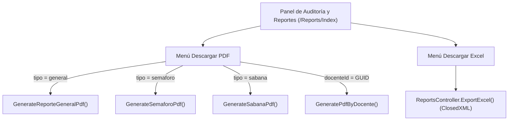

# 5. Motor de Reportes y Analítica — SIARAWEB

## 5.1 Arquitectura del Servicio de Reportes (`PdfGeneratorService`)
El servicio [`Services/PdfGeneratorService.cs`](../SIARAWEB/Services/PdfGeneratorService.cs) encapsula la generación de documentos PDF utilizando la API fluida de **QuestPDF** con la tipografía integrada `Lato`.

---

## 5.2 Especificación de los 4 Tipos de Reportes PDF

### 1. Reporte Ejecutivo General (`GenerateReporteGeneralPdf`)
Diseñado para la toma de decisiones de Subdirección Académica y Jefaturas de Carrera. Contiene **4 secciones estructuradas** en formato horizontal (`A4 Landscape`):
- **Sección 1 — Resumen Ejecutivo de KPIs Institucionales:**
  - Cobertura académica (total de asignaturas evaluadas, docentes activos y carreras incluidas).
  - Promedios globales de **Aprobación**, **Reprobación** y **Deserción**, junto con el conteo de unidades registradas y alertas críticas.
  - Resumen de auditoría documental: total de evidencias subidas, entregas a tiempo, entregas tardías, documentos aprobados y rechazados.
- **Sección 2 — Concentrado Comparativo por Departamento / Carrera:**
  - Agrupa todas las asignaturas por departamento y calcula para cada carrera: total de materias, total de docentes, evidencias entregadas, porcentaje de puntualidad (`% a tiempo`), `% Aprobación`, `% Reprobación`, `% Deserción` y unidades en riesgo.
- **Sección 3 — Matriz Integral (Semáforo Documental + Sábana Académica):**
  - Cruza en una sola tabla por asignatura el estatus de las 4 fases (`Inicial`, `Seg. 1`, `Seg. 2`, `Final`: `A TIEMPO`, `DESFASADO`, `PENDIENTE`), el total de documentos subidos y los porcentajes de aprobación, reprobación, deserción y nivel de riesgo.
- **Sección 4 — Bitácora de Alertas Críticas ($\ge 40\%$ Reprobación) y Acciones Correctivas:**
  - Filtra todas las unidades temáticas con `FailurePercentage >= 40.0m` y expone la asignatura, el docente titular, la unidad afectada, el porcentaje de reprobación, el texto íntegro de la **Estrategia Remedial / Acción Correctiva** y el **Dictamen de Jefatura** (`APROBADO`, `RECHAZADO`, `PENDIENTE`).

### 2. Reporte de Semáforo de Entregas (`GenerateSemaforoPdf`)
Enfocado en la auditoría de cumplimiento documental cronometrado:
- Encabezado con KPIs de asignaturas auditadas, total de evidencias, entregas a tiempo, entregas desfasadas y documentos validados.
- Tabla detallada con el estado cromático de cada asignatura en `Fase Inicial`, `1er Seguimiento`, `2do Seguimiento` y `Reporte Final`.

### 3. Sábana de Rendimiento Académico (`GenerateSabanaPdf`)
Enfocado exclusivamente en los indicadores cuantitativos de calificaciones:
- KPIs superiores de materias evaluadas y promedios de aprobación, reprobación y deserción.
- Tabla de asignaturas con conteo de temas evaluados, promedios porcentuales y resaltado en rojo (`#fee2e2`) de las materias con unidades en riesgo.

### 4. Reporte Individual por Docente (`GeneratePdfByDocente`)
Generado en formato vertical (`A4 Portrait`) al seleccionar un profesor desde el modal `_SelectDocente.cshtml` o desde el botón directo en el expediente de asignatura (`Details.cshtml`):
- Ficha técnica del profesor (nombre completo, correo, departamento de adscripción y total de asignaturas impartidas en el periodo).
- KPIs individuales del docente (promedio de aprobación, reprobación, deserción y total de evidencias subidas).
- Desglose por cada asignatura impartida, indicando grupo y tabla unidad por unidad con porcentajes y dictamen de observaciones.

---

## 5.3 Exportación a Excel (`ExportExcel` con ClosedXML)
La acción `ReportsController.ExportExcel` genera un libro `.xlsx` con la hoja `Sabana_Rendimiento`:
- Incluye encabezado institucional y metadatos del periodo escolar.
- Columnas: `Código`, `Asignatura`, `Docente Titular`, `Departamento`, `Seguimientos`, `Aprobación (%)`, `Reprobación (%)`, `Deserción (%)`, `Alertas (>=40%)` y `Estado de Riesgo`.
- Aplica formato condicional automático: las filas en riesgo (`avgReprob >= 40%` o con unidades críticas) se colorean con fondo rojo claro (`RGB(254, 226, 226)`) y texto en negritas rojo.

---

## 5.4 Visor Interactivo de Expediente y Persistencia de Pestañas (`Reports/Details`)
- **Persistencia Contextual (`tab=semaforo` vs `tab=sabana`):**
  - Cuando el usuario inspecciona una asignatura desde el **Semáforo**, la vista `Details.cshtml` abre automáticamente la pestaña del **Visor de Documentos**; si entra desde la **Sábana**, abre directamente la pestaña de **Calificaciones por Unidad**.
  - Al cambiar de pestaña dentro de `Details.cshtml`, un script actualiza en vivo el botón **Volver** para regresar exactamente a la pestaña correspondiente del tablero principal conservando los filtros de periodo, departamento y búsqueda.
- **Visor PDF Embebido:**
  - Permite filtrar los documentos entregados por fase (`Todas`, `Inicial`, `1er Seguimiento`, `2do Seguimiento`, `Reporte Final`) y previsualizar cualquier archivo PDF en el panel lateral derecho sin recargar la página.
